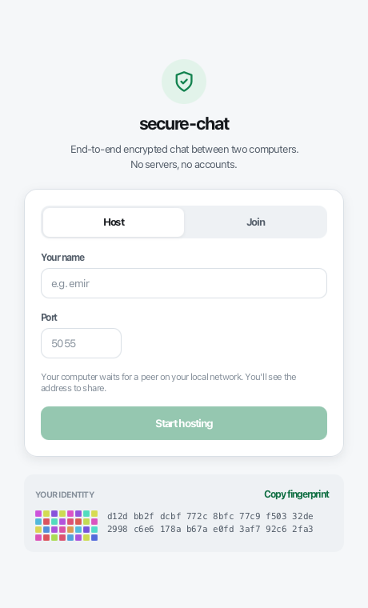
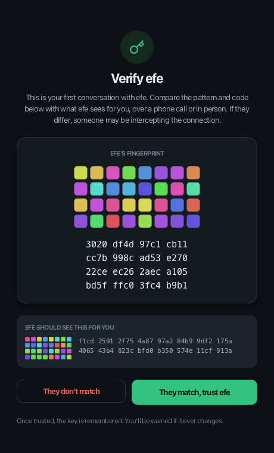
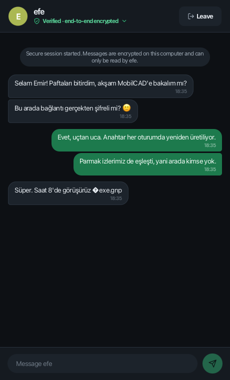
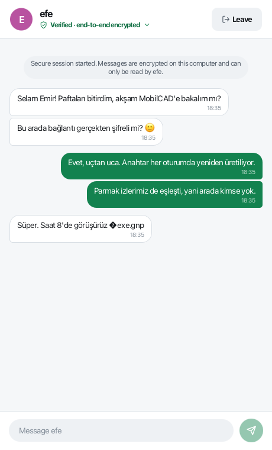
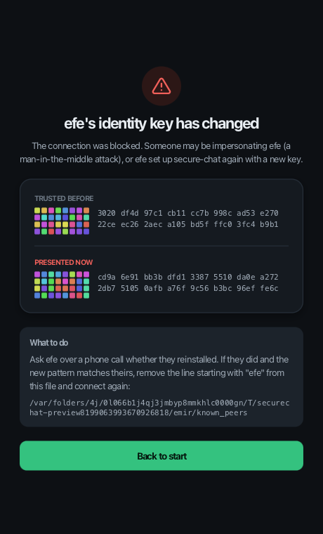
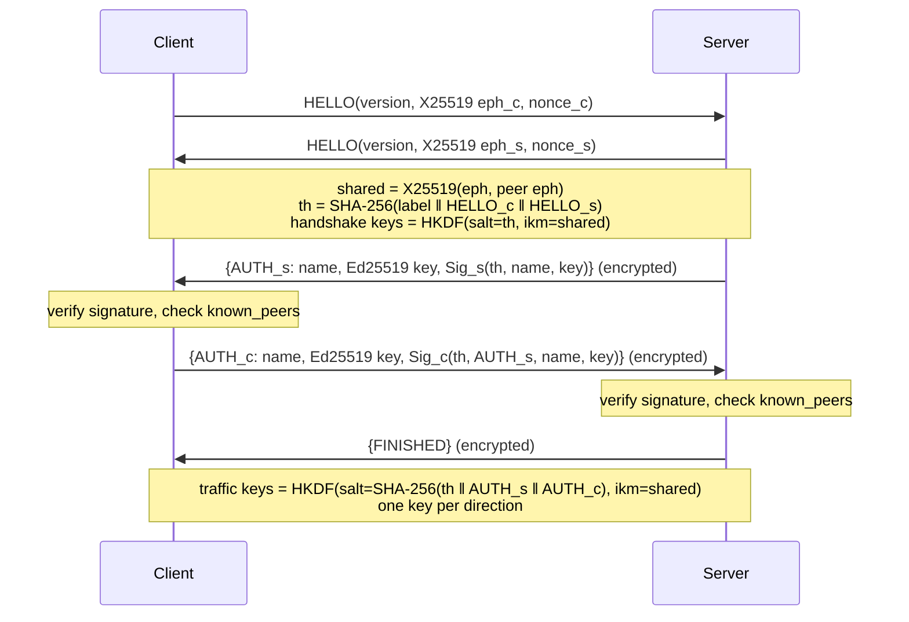

# secure-chat

[](https://github.com/aemircicek/secure-chat/actions/workflows/ci.yml)

End-to-end encrypted, mutually authenticated 1:1 chat for the desktop and the terminal,
written in Java using only the JDK's standard cryptography (no third-party crypto libraries).

<p align="center">
  
  
  
</p>

It started as a small socket chat that "encrypted" messages with a hard-coded AES key in ECB
mode. Version 2 replaces that with a modern design: an authenticated key exchange
(SIGMA-I style, X25519 + Ed25519), HKDF key derivation, AES-256-GCM records with replay
protection, and SSH-style trust-on-first-use for identity keys. Version 2.1 adds a desktop app.

## Quick start

Download the jar for your platform from the [latest release](https://github.com/aemircicek/secure-chat/releases/latest)
(Java 21+ required), or build it yourself with `mvn verify`.

```sh
java -jar secure-chat.jar                                   # desktop app
java -jar secure-chat.jar host --name emir                  # terminal: wait for a peer on port 5055
java -jar secure-chat.jar connect 192.168.1.3 --name efe    # terminal: connect to a host
java -jar secure-chat.jar fingerprint                       # show your identity key
```

Options: `--port <n>` (default 5055; 5000 is taken by AirPlay on macOS), `--bind <addr>` (host only,
default `0.0.0.0`), `--home <dir>` (keys and known peers, default `~/.securechat`; also works with
`gui`, handy for running two identities on one machine). Type `/quit` to leave a terminal chat.
The desktop app and the terminal speak the same protocol and can talk to each other.

### Desktop app

- **Host / Join**: one person hosts and sees the LAN addresses to share; the other joins.
- **Fingerprint verification**: on first contact both sides see each other's key as a colour
  pattern plus hex code. Compare them on a call; a mismatch is visible at a glance.
- **Key-change warning**: if a trusted peer ever presents a different key, the connection is
  blocked with a full-screen warning showing the old and new keys.
- **Session details**: click *Verified · end-to-end encrypted* in a chat to see both keys and the protocol.
- Follows the system's light/dark appearance.

<p align="center">
  
  
</p>

### Terminal

```
$ secure-chat host --name emir
Listening on 0.0.0.0:5055 as 'emir'.
Your fingerprint: e41e 2a9a 3ac4 3c70 63a4 4763 0f75 8bcf d9de 0cc6 ea75 2ea2 3b87 1461 37da c02a
Waiting for a peer...
Peer connected from /192.168.1.7:52458, authenticating...

First connection to 'efe'. Their identity fingerprint is:
0087 200b 470b e8b0 5f87 a136 041e 436c
c1ea 0979 e741 e968 85ad 33c6 19a0 d62b
Compare it with efe over another channel (in person, phone call).
Trust and remember this key? [y/N] y
Secure session established with 'efe' (X25519 + Ed25519, AES-256-GCM). Type /quit to leave.
[17:49] efe: Merhaba Emir
```

On first contact each side is shown the other's fingerprint. **Compare it over another channel**
(read it out on a phone call, or in person) before answering `y`. After that the key is pinned
in `~/.securechat/known_peers`, and any change is refused with a loud warning.

## Security design

### Threat model

The attacker controls the network: they can read, drop, modify, replay, reorder and inject
packets, and can impersonate either endpoint at the TCP level. Endpoints themselves (the two
computers) are trusted.

| Goal | How it is achieved |
|---|---|
| Confidentiality | AES-256-GCM with keys from an ephemeral X25519 exchange |
| Integrity | GCM authentication tag on every record and handshake message |
| Mutual authentication | Each side signs the handshake transcript with its long-term Ed25519 key |
| No MITM | Identity keys are verified out-of-band once, then pinned (TOFU) |
| Forward secrecy | Fresh X25519 keys per session; stealing `identity.key` later does not decrypt past chats |
| Replay / reorder / drop protection | Implicit per-direction 64-bit counters as GCM nonces |
| Reflection protection | Separate keys for each direction |
| Identity hiding (passive) | Names and identity keys are sent encrypted |
| Sender spoofing | The display name comes from the authenticated handshake, never from message text |
| Terminal / display injection | Control characters, ANSI escapes and bidi overrides from the peer are neutralised |
| Resource exhaustion | 64 KiB frame limit, 4 KiB message limit, 120 s handshake timeout |

### Handshake



This follows the SIGMA-I pattern used by IKEv2 and TLS 1.3: signatures cover the full
transcript, so an attacker cannot swap the ephemeral keys, and because the AUTH messages are
encrypted under keys derived from the shared secret, a valid AUTH also proves the sender
completed the same key exchange. Low-order X25519 points (all-zero shared secret) are rejected.

### Record layer

Every chat message is a binary record `type ‖ timestamp ‖ text` encrypted with AES-256-GCM.
The 96-bit nonce is `0x00000000 ‖ counter` and the counter is never sent: the receiver expects
exactly the next value, so a replayed, reordered, dropped or modified record fails
authentication and the connection is closed.

### Code map

| Package | Responsibility |
|---|---|
| `com.emirchat.crypto` | `Hkdf` (RFC 5869), `Identity` (Ed25519 keys, fingerprints, owner-only key files) |
| `com.emirchat.protocol` | `FrameIO` (bounded framing), `Wire` (strict encoding), `Handshake`, `SecureChannel` |
| `com.emirchat.trust` | `KnownPeers` (TOFU store) |
| `com.emirchat.net` | `Connector` (host/connect + handshake, cancellable), `LocalAddresses` |
| `com.emirchat.chat` | `Conversation` (UI-independent chat), `ChatMessage`, `TerminalSanitizer`, `ChatSession` (terminal) |
| `com.emirchat.ui` | JavaFX desktop app: screens, theme (`app.css`), fingerprint art |
| `com.emirchat` | `Main` (desktop or CLI), `SecureChat` command-line interface |

### Tests

`mvn verify` runs 34 tests, including RFC 5869 test vectors and attack scenarios: tampered,
replayed, reordered and reflected records; an impersonator presenting a different key for a
pinned name; bit-flips on the wire during the handshake (through a relay); a server that
rejects the client (the client must not report success); and conversations ending cleanly or
by connection loss. CI also runs a Semgrep security scan.

`src/test/java/com/emirchat/ui/UiPreview.java` drives the real desktop UI through a full session
against a scripted peer (host, verify, chat, key-change attack, error) and saves a screenshot of
every step; the images above come from it.

## Limitations

Honest notes on what this project does **not** do:

- **Not audited.** It is a learning and portfolio project. For real-world secrecy use Signal.
- **Identity key at rest is unencrypted** (protected only by `0600` file permissions).
- **TOFU trusts names the user accepts.** An attacker can still present a *new* name; the user
  must actually compare fingerprints on first contact.
- **Server identity is visible to an active attacker** (as in SIGMA-I); the client's is not.
- **No post-compromise security / ratcheting** (unlike Signal's Double Ratchet). One key pair per session.
- **One peer per host session**, and a connecting attacker can occupy the slot until the handshake times out.
- **Best-effort key wiping** only: the JVM may keep copies of key material in memory.

## Roadmap

- Passphrase-encrypted identity key (PBKDF2/Argon2 + AES-GCM)
- Group chat with per-member keys
- Rekeying after N messages and a ratchet for post-compromise security
- Native installers (jpackage) with code signing
- Fuzzing the decoders (Jazzer)

## Security

See [SECURITY.md](SECURITY.md) for how to report a vulnerability.

## License

[MIT](LICENSE) © 2026 Emir Çiçek. Icons adapted from [Feather](https://github.com/feathericons/feather) (MIT).
