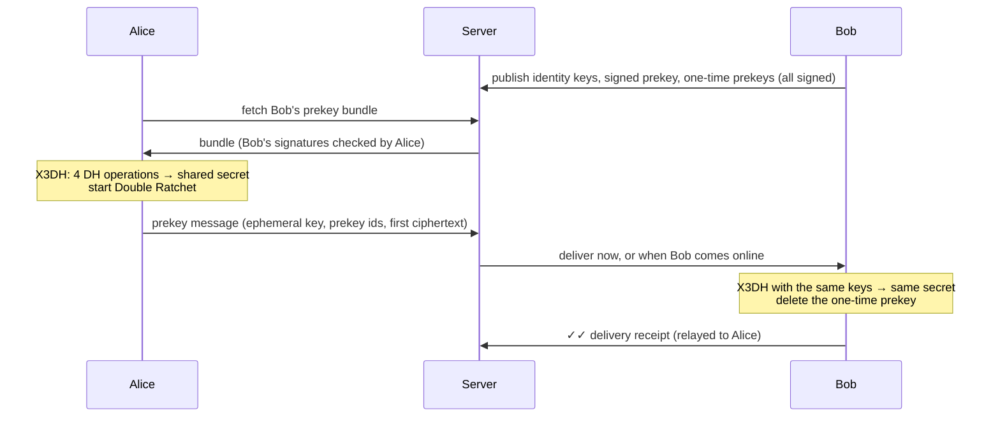
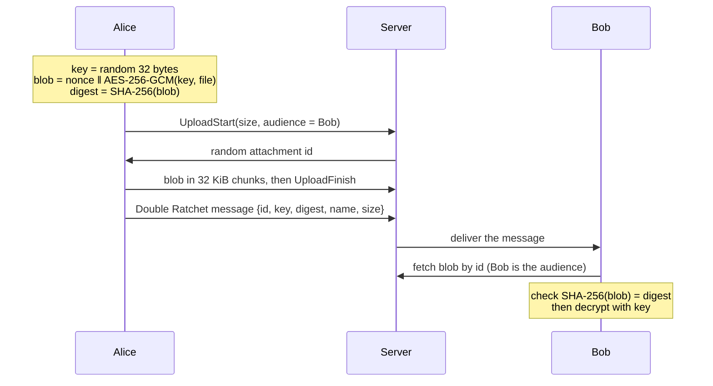

# secure-chat

[](https://github.com/aemircicek/secure-chat/actions/workflows/ci.yml)

End-to-end encrypted messenger for the desktop and the terminal: accounts, friends, direct
messages and groups, written in Java using only the JDK's standard cryptography (no
third-party crypto libraries). The server relays and stores messages it cannot read.

<p align="center">
  
  
</p>

It started as a small socket chat that "encrypted" messages with a hard-coded AES key in ECB
mode. Version 2 replaced that with an authenticated key exchange (SIGMA-I style, X25519 +
Ed25519) between two peers. **Version 3** turns it into a messenger with a server, using the
same ideas as Signal: X3DH to start sessions with offline users, the Double Ratchet for every
direct message, and Sender Keys for groups.

## Quick start

Download the jar for your platform from the [latest release](https://github.com/aemircicek/secure-chat/releases/latest)
(Java 21+ required), or build it yourself with `mvn verify`.

```sh
java -jar secure-chat.jar server                    # run a server on port 5056
java -jar secure-chat.jar                           # desktop app: register or log in
```

In the desktop app, enter the server address (for example `localhost:5056`, or the server's LAN
address), then register a username and password. To try it alone on one machine, open two app
windows with different key directories:

```sh
java -jar secure-chat.jar gui --home ./alice
java -jar secure-chat.jar gui --home ./bob
```

### Desktop app

- **Accounts**: register and log in with a username and password.
- **Server verification**: on first connection the app shows the server's key fingerprint; after
  that it is pinned and a different key is refused.
- **Friends**: send, accept and decline requests; see who is online.
- **Direct messages**: end-to-end encrypted, delivered later if your friend is offline, with
  ✓ sent / ✓✓ delivered marks and unread counts.
- **Groups**: create a group from your friends, add and remove members, rename it, leave; the
  owner role passes to the longest-standing member if the owner leaves. Group names are end-to-end
  encrypted: the server stores only ciphertext.
- **Contact verification**: compare a friend's key as a colour pattern and hex code, then mark
  them verified.
- **Key-change warning**: if a friend's key changes (new device, or an attack), messages to them
  are held back until you verify the new key.
- **Files and images**: send any file up to 25 MB to a friend or a group (📎 next to the message
  box). Each file is encrypted with its own key before it leaves your computer; images are
  previewed in the chat.
- **Disappearing messages**: set a timer for a chat (5 minutes to 1 week) with the ⏱ button.
  Everyone in the chat gets the same setting, and new messages and files are deleted from every
  device's history that long after they arrive.
- **Encrypted history**: messages are stored on disk encrypted under a key derived from your password.
- Light and dark themes, following the system.

<p align="center">
  
</p>

<p align="center">
  
  
  
</p>

### Terminal

```sh
java -jar secure-chat.jar server [--port 5056] [--bind 0.0.0.0] [--data ~/.securechat-server]
java -jar secure-chat.jar register --server localhost:5056 --username emir
java -jar secure-chat.jar client   --server localhost:5056 --username emir
```

`client` opens an interactive shell (`msg`, `file`, `save`, `timer`, `friends`, `add`, `accept`, `group`, `gmsg`,
`verify`, `trust`, ...; type `help` for the full list). The desktop app and the terminal client
use the same protocol and can talk to each other.

### Direct mode (no server)

The version 2 peer-to-peer mode is still available: one person hosts, the other connects
directly, and nothing is stored anywhere. In the desktop app, choose *Direct connection without
an account* on the login screen; in the terminal:

```sh
java -jar secure-chat.jar host --name emir                  # wait for a peer on port 5055
java -jar secure-chat.jar connect 192.168.1.3 --name efe    # connect to a host
java -jar secure-chat.jar fingerprint                       # show your identity key
```

## Security design

### Threat model

The attacker controls the network: they can read, drop, modify, replay, reorder and inject
packets. **The server is not trusted with message content**: a malicious or compromised server
must not be able to read or forge messages. User devices are trusted.

| Goal | How it is achieved |
|---|---|
| Confidentiality against the server | Messages are encrypted on the sender's device; the server stores and relays opaque bytes |
| Confidentiality and integrity on the wire | Every connection is a SIGMA-I channel (X25519 + Ed25519, AES-256-GCM); the server's key is pinned on first use |
| Asynchronous session setup | X3DH with signed prekeys (rotated weekly) and one-time prekeys (deleted after use) |
| Forward secrecy | Double Ratchet: every message has its own key, which is deleted after use |
| Post-compromise security | Double Ratchet DH steps: a stolen session state stops working once both sides send again |
| No fake keys from the server | Every published key is signed by the user's Ed25519 identity; friends' keys are pinned (TOFU) and can be verified by fingerprint |
| Key changes | A changed key holds outgoing messages until the user verifies it |
| Group confidentiality | Sender Keys: each member's chain key is sent to other members over the pairwise encrypted channel |
| Group authenticity | Each group message is signed with the sender's group signing key; members cannot forge each other |
| Group names | Encrypted with a name key that the admin sends to members end-to-end, bound to the group id; a new key after anyone leaves |
| Removed members | Everyone rotates to a fresh sender key that departed members never receive; new members cannot read earlier messages |
| Replay | Ratchet and chain keys only move forward; decryption is transactional, so a forged or replayed message cannot corrupt state |
| Password storage | PBKDF2-HMAC-SHA256, 600,000 iterations, 16-byte random salt per user |
| Online guessing | 5 failed logins per username and 20 per IP address in 15 minutes |
| Username enumeration on login | Same error and same hashing cost for unknown usernames |
| Stolen disk | Message history encrypted with AES-256-GCM under a key from the account password (PBKDF2, 600k) |
| File confidentiality | Each file is encrypted with a fresh AES-256-GCM key; the server stores only the ciphertext, and the key travels in an end-to-end encrypted message |
| File integrity | The receiver checks the SHA-256 digest of the blob (sent end-to-end) before decrypting; GCM authenticates the content |
| File access | Only the uploader and the named audience (the friend, or current group members) can download; unknown and forbidden ids look the same |
| Disappearing messages | The timer travels inside the encrypted message; expired rows are deleted with SQLite `secure_delete` and cached files are removed |
| Resource exhaustion | Frame and message size limits, offline queue and prekey caps, prekey-fetch rate limits, 25 MB per file, 250 MB of stored files per user |

### Direct messages: X3DH and the Double Ratchet



This follows Signal's X3DH (revision 1) and Double Ratchet (revision 4) specifications, with one
change taken from Matrix's Olm: the Ed25519 signing identity and the X25519 agreement identity are
separate keys, and the X25519 key is signed by the Ed25519 one. Every signature is checked before
any DH is computed. The associated data of every message is both parties' identity keys, so a
ciphertext cannot be moved into a session between different people.

### Groups: Sender Keys

Each member owns a sender key per group: a hash chain (each message key is used once and the
chain only moves forward) and an Ed25519 signing key. A message is encrypted once, signed, and
fanned out by the server. When anyone leaves or is removed, every remaining member rotates to a
new sender key. Removal is also checked at send time, so a member removed while you were offline
does not receive your next message.

### Group names

The group's admin creates a random 32-byte name key, encrypts the name with AES-256-GCM (the group
id and key version are authenticated as associated data, so the server cannot move a name to
another group) and stores only that ciphertext on the server. The key travels to each member over
the pairwise Double Ratchet channel and is accepted only from the current admin. When anyone
leaves or is removed, the admin makes a new key version and re-encrypts the name, so former
members cannot read later names. Groups named in plain text by version 3.0 are moved to an
encrypted name the next time their admin's app connects.

### Files



The server never sees the key, the file name or the content. Blobs are deleted after 30 days
(unfinished uploads after an hour). File names from other people are reduced to a plain name
(no folders, control characters or right-to-left tricks) before they are shown or saved.

### Transport

Clients and the server talk over the same SIGMA-I channel as the direct mode: an ephemeral X25519
exchange, Ed25519 signatures over the transcript, HKDF-SHA256 keys per direction, and AES-256-GCM
records with implicit counters, so replayed, reordered or modified records close the connection.
Users then authenticate with their password inside the channel. Low-order X25519 points are rejected.

### Code map

| Package | Responsibility |
|---|---|
| `com.emirchat.crypto` | `Hkdf` (RFC 5869), `Identity` (Ed25519 keys, fingerprints), `X25519` |
| `com.emirchat.protocol` | `FrameIO` (bounded framing), `Wire` (strict encoding), `Handshake` (SIGMA-I), `SecureChannel` |
| `com.emirchat.e2e` | `X3dh`, `DoubleRatchet`, `GroupKeys` (Sender Keys), `Attachments` (file encryption), `Messenger`, `DeviceKeys`, `PrekeyBundle` |
| `com.emirchat.server` | `ChatServer`, accounts, friends, groups, offline queue, `AttachmentService`, `PasswordHasher`, `RateLimiter`, SQLite |
| `com.emirchat.client` | `ChatClient`, `ServerConnection`, encrypted `History` |
| `com.emirchat.api` | `Packet` (client–server messages), error codes |
| `com.emirchat.trust` | `KnownPeers` (TOFU store for servers and contacts) |
| `com.emirchat.ui` | JavaFX desktop app: screens, theme, fingerprint art |
| `com.emirchat.chat` | `ChatMessage`, `FileMessage` (file description and safe names), terminal sanitising |
| `com.emirchat.net` | Direct mode: connect/host |
| `com.emirchat` | `Main`, `SecureChat` and `AccountCli` command lines, `ClientShell` |

### Tests

`mvn verify` runs 139 tests, including RFC 5869 test vectors and attack scenarios:

- **Transport**: tampered, replayed, reordered and reflected records; an impersonated client or
  server presenting a different key; tampered handshake messages.
- **Direct messages**: out-of-order delivery, replays, tampering that must not break the session,
  authenticated headers, a prekey bundle for a different identity, forged signed prekeys,
  one-time prekeys used only once, simultaneous first messages, sessions surviving a restart.
- **Groups**: removed members cannot read after rotation (even if the removal happened while a
  member was offline), new members cannot read old messages, members cannot forge each other,
  redistributing an old chain state cannot enable replays; group names are unreadable to the
  server, bound to their group, re-keyed after a removal, and old name keys cannot be replayed.
- **Files**: a blob swapped or modified on the server is refused, a wrong key fails, only the
  recipient or current group members can download, uploads must arrive in order and in full,
  expiry and per-user quotas, hostile file names (`../../etc/passwd`, right-to-left overrides).
- **Server**: registration and login rules, identical errors for wrong password and unknown user,
  brute-force limits, friend and group permissions, the offline queue in order, delivery
  receipts, a tampering server being caught, and the server storing only ciphertext.

CI also runs a Semgrep security scan. `src/test/java/com/emirchat/ui/AccountPreview.java` drives
the real desktop app against an in-process server and scripted users and saves a screenshot of
every step; the images above come from it.

## Limitations

Honest notes on what this project does **not** do:

- **Not audited.** It is a learning and portfolio project. For real-world secrecy use Signal.
- **The server sees metadata**: who is friends with whom, who messages whom and when, group
  member lists, online status, and the approximate size of each file. It cannot see message
  content, group names, file names or file content.
- **The server can hide or delay messages**, and can claim a user has a new device. The app then
  shows a key-change warning; users must compare fingerprints to detect a fake key.
- **TOFU trusts first contact.** Until friends compare fingerprints, a malicious server could
  present a fake key on the very first exchange.
- **One device per account.** Logging in on a new device replaces the old key.
- **Keys at rest are not encrypted**: identity keys and ratchet sessions are protected only by
  owner-only file permissions (message history is encrypted).
- **Disappearing messages rely on the other side's app.** They protect against a device being
  lost or seized later, not against a recipient who takes a screenshot or runs a modified client.
  The terminal client keeps no history at all.
- **Registration reveals whether a username is taken.**
- **Best-effort key wiping** only: the JVM may keep copies of key material in memory.

## Roadmap

- Passphrase-encrypted identity keys and session state
- QR-code contact verification
- Fuzzing the decoders (Jazzer)
- Deployment guide for a VPS (Docker, firewall)
- Multiple devices per account; voice messages

## Security

See [SECURITY.md](SECURITY.md) for how to report a vulnerability.

## License

[MIT](LICENSE) © 2026 Emir Çiçek. Icons adapted from [Feather](https://github.com/feathericons/feather) (MIT).
